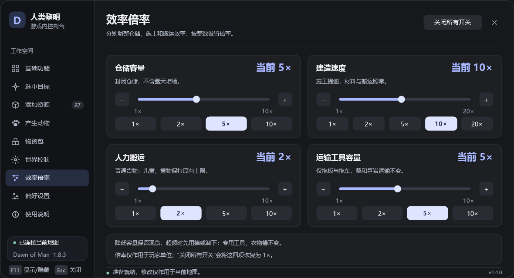

# 人类黎明内置修改器 · Dawn of Man Trainer

在游戏内按 **F11** 打开控制台，管理人物状态、资源、动物、建筑与世界。资源目录、物资包、效率倍率和偏好设置均集成在同一面板的标签页中。

**当前版本：v1.4.0** · 本次实测：本机 Steam **Dawn of Man 1.8.3 / Unity 2022.3.60f1 / Windows**。安装器按原始游戏程序集哈希校验支持范围；这不代表已验证所有游戏版本。

**[下载最新 Release 安装包](https://github.com/lyfhc0305/dawn-of-man-trainer/releases/latest)**，选择 `DawnOfManTrainer-v1.4.0.zip`，解压后即可安装。仓库的 **Code → Download ZIP** 是源码包，使用前需要构建。

[详细说明](docs/使用说明.txt) · [更新记录](docs/更新说明.txt) · [v1.4.0 验证记录](docs/1.4.0倍率验证结果.txt)

下面是 v1.4.0 共用界面的**离线渲染预览**，不是游戏内截图。倍率页采用 640 高的紧凑窗口，每项卡片高 190；其他页面保留原有窗口尺寸与字号。



## 功能

| 标签页 | 功能 |
| --- | --- |
| 基础功能 | 七项人物属性锁、可选保护家畜、知识点、最高 15 倍速度、选中目标概览 |
| 选中目标 | 平均生存状态预览、一次性恢复健康与属性、快速完成建造、杀死选中单位、建筑缺料补给与修缮、工具及衣物耐久、符合原生条件的幼年动物驯化 |
| 添加资源 | 真实游戏目录、名称或英文 ID 搜索、分类、收藏、手动数量、选中目标附近或画面中心生成 |
| 产生动物 | 选择物种、年龄、性别、数量与生成位置 |
| 物资包 | 保存与编辑多种资源清单、一次添加整包、先完整校验再按快照执行、停止后续生成 |
| 世界控制 | 0.25× / 0.5× 慢速、倍率切换、暂停、五种天气、原生流程邀请移民和商人 |
| 效率倍率 | 仓储容量、建造速度、人力搬运、拖板与拖车容量四项独立整数倍率 |
| 偏好设置 | 自定义单键、游戏键位冲突检查、面板自动暂停、收藏及物资包等偏好自动保存 |
| 使用说明 | 快捷键、添加资源步骤与使用提示 |

### 效率倍率

四项均支持整数吸附滑块、每次增减 1× 和常用档位按钮，**最低与默认值均为 1×**。

| 项目 | 范围 | 生效范围 |
| --- | --- | --- |
| 仓储容量 | 1–10× | 已建成的玩家封闭储藏建筑；排除露天可见堆场 |
| 建造速度 | 1–20× | 玩家村民对玩家建筑的正常施工进度；材料交付与搬运照常，保留原生完工及知识奖励 |
| 人力搬运 | 1–10× | 玩家成年、老年村民的普通货物容量；儿童、重物及专用工具、衣物装备槽保持原规则 |
| 运输工具容量 | 1–10× | 已建成的玩家拖板与拖车；犁和巨岩运输方式保持原规则 |

容量倍率扩大同类货物槽的容量，不增加槽位数量；实际一趟运量还受混装、收集范围和派工影响。降低倍率会保留已有物品，超额槽位允许卸出、拒绝继续装入。倍率不保存到偏好，切换地图或点击“关闭所有开关”均恢复 1×；未进入地图时无法调整。

## 安装与使用

1. 从 [最新 Release](https://github.com/lyfhc0305/dawn-of-man-trainer/releases/latest) 下载 `DawnOfManTrainer-v1.4.0.zip` 并完整解压。
2. 退出游戏，双击解压目录里的 `安装.cmd`。安装器优先使用 `D:\Program Files (x86)\Steam\steamapps\common\DawnOfMan`；该目录不存在、且安装器所在文件夹的同级 `DawnOfMan` 目录存在时，改用该同级目录。
3. 游戏安装在其他位置时，在解压目录中运行 `.\Installer.exe "你的游戏目录"`，例如 `.\Installer.exe "E:\DawnOfMan"`。
4. 启动游戏并进入地图，按 **F11** 打开 / 隐藏面板，**Esc** 关闭。
5. 面板打开时，可以直接在**面板外的地图上点选目标**，再在“选中目标”页操作；支持多选。

默认 **Ins / Del / F10** 分别对应快速完成建造、杀死选中单位、重复添加资源，需先在对应页面启用开关。动作快捷键只在面板关闭、正常地图交互且没有菜单或输入焦点时生效；F8 保留给原游戏家畜面板。持续修改与动作快捷键开关每次启动默认关闭。

安装器校验游戏程序集、保留原始备份，并提供失败回滚和中断恢复。遇到未完成事务时，重新运行安装或卸载完成恢复后再启动游戏。卸载请先退出游戏，再运行 `卸载.cmd`，或执行 `.\Installer.exe --uninstall "你的游戏目录"`；安装校验可运行 `.\Installer.exe --verify "你的游戏目录"`。

资源在地图地面生成，仍由村民搬运；建筑缺料补给仍需村民交付和施工。健康锁不会拦截寿命结束、雷击等直接死亡机制。选中村民执行杀死操作需要再次确认；添加物品、建造和死亡等实际修改结果会随用户存档保存。

## 验证

v1.4.0 在上述 **1.8.3** 环境中完成以下检查，合计 **600 项通过 / 0 失败**：

| 类别 | 结果 | 覆盖内容 |
| --- | --- | --- |
| 核心、功能与交付程序集离线检查 | 133 / 0 | 功能策略、倍率范围、安全边界及二进制引用 |
| 共用界面离线检查 | 218 / 0 | 动作派发、整数步进、滑块取整与边界、非有限值、无地图禁用、紧凑布局 |
| 独立安装器检查 | 137 / 0 | 安装与卸载事务、中断恢复、外部修改保护、倍率挂接与签名校验 |
| 真实游戏内自检 | 112 / 0 | 含 33 项新增倍率检查、实际装卸数量守恒、降倍率保留库存、施工进度与完工奖励 |

实际鼠标操作验证了仓储滑块 **5× → 10×**、建造滑块的非预设 **14×**，以及重置四项至 **1×**。切回基础功能页后窗口恢复 800 高，未出现内容裁切。离线预览可导出 27 张，包含倍率页的 1280×720、1366×768 展示。

测试使用临时未保存地图；本次尚未完成自然 AI 接单、寻路、拾取、卸货的长期全流程验收，也未完成超原容量物品的存档、退出、重新载入循环。存档相关代码核查和内存库存保持检查不等同于完整存读档验证。

当前完整证据见 [v1.4.0 倍率验证结果](docs/1.4.0倍率验证结果.txt)。[旧版验证记录](docs/验证结果.txt)、[历史审阅](docs/Astra界面评价.txt)与 [6 张旧版真实游戏截图](docs/screenshots)保留供追溯，其中旧版本及旧环境记录不作为 v1.4.0 的实测结论。

下面为旧版真实游戏中的资源添加截图，非本次 v1.4.0 验证截图：


## 从源码构建

从仓库克隆或使用 **Code → Download ZIP** 获取源码。需要 Windows 自带 .NET Framework C# 编译器，以及本机已安装的适配游戏；**不需要 .NET SDK**。

在 PowerShell 中运行，按实际位置修改 `-GamePath`：

```powershell
.\Build.ps1 -GamePath 'E:\DawnOfMan'
.\Test.ps1 -GamePath 'E:\DawnOfMan'
.\TestInstaller.ps1
```

构建生成 `DawnOfManTrainer.dll` 和 `Installer.exe`。`Test.ps1` 运行核心与界面离线检查，`TestInstaller.ps1` 在独立临时目录验证安装器事务；两者均不启动游戏，也不对真实游戏执行安装。

游戏内诊断仅在显式指定 `--trainer-self-test` 时执行，普通启动不会执行测试或抑制自动存档。

```text
src/TrainerMultipliers.cs             仓储、施工、人力与运输工具倍率接入
src/IntegrationMultiplierChecks.cs    倍率功能的真实地图状态自检
src/                                 其他修改器逻辑、共用界面、Unity 绘制、安装器和诊断
tests/                               策略、程序集、安装器、界面检查及离线预览导出
docs/                                说明、当前及历史验证日志、预览与历史游戏截图
Build.ps1                            构建修改器与安装器
Test.ps1                             核心与界面离线验证
TestInstaller.ps1                    独立安装器事务与挂接验证
```

构建时引用本机游戏程序集。仓库和 Release 安装包均不包含游戏原程序集、反编译游戏源码或独立游戏素材。随附第三方依赖 Mono.Cecil 0.11.6，其许可证见 [Mono.Cecil.LICENSE.txt](Mono.Cecil.LICENSE.txt)。
