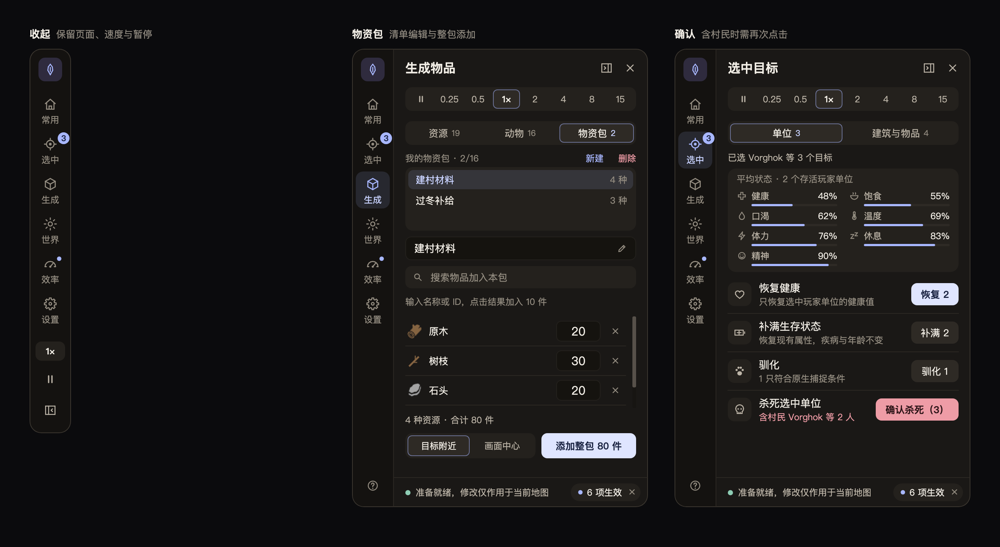

# 人类黎明内置修改器 · Dawn of Man Trainer

在游戏内按 **F11** 打开控制台，管理人物状态、资源、动物、建筑与世界。面板停靠在屏幕右侧，不挡住地图中央，可收起为窄栏或拖成浮动窗口。

**[下载最新版本](https://github.com/lyfhc0305/dawn-of-man-trainer/releases/latest)**：选择 `DawnOfManTrainer-v2.0.0.zip`。仓库的 **Code → Download ZIP** 是源码，不能直接安装。

## 截图

截图由界面代码离线渲染，物品与动物图标为示意；游戏内显示原始贴图。

## 功能

| 页面 | 功能 |
| --- | --- |
| 每页顶部 | 暂停与 0.25×–15× 常用速度；底栏显示生效的修改数量，可一键全部关闭或停止后续生成 |
| 常用 | 七项人物属性锁与“全部”方块、同时保护家畜、知识点、正在生效的修改列表（可逐项关闭） |
| 选中 | 单位：平均生存状态、恢复健康与属性、驯化符合原生条件的幼年动物、杀死选中单位；建筑与物品：补齐缺料、快速完成建造、修缮建筑、恢复工具与衣物耐久 |
| 生成 | 资源：游戏内全部物品，可按名称或英文 ID 搜索、分类与收藏；动物：物种、年龄、性别；物资包：保存多种资源清单，一次添加整包 |
| 世界 | 1–15 任意整数倍速度、五种天气、邀请移民和商人、打开面板时自动暂停 |
| 效率 | 仓储容量、建造速度、人力搬运、拖板与拖车容量四项整数倍率 |
| 设置 | 三个动作快捷键的启用与改键、停靠位置、界面大小；收藏、物资包等偏好自动保存 |

### 效率倍率

四项都用滑块或加减按钮按整数调整，**最低与默认值均为 1×**。

| 项目 | 范围 | 生效范围 |
| --- | --- | --- |
| 仓储容量 | 1–10× | 已建成的玩家封闭储藏建筑，不含露天堆场 |
| 建造速度 | 1–20× | 玩家村民的正常施工进度；材料交付与搬运照常，保留原生完工奖励 |
| 人力搬运 | 1–10× | 玩家成年、老年村民的普通货物；儿童、重物与装备槽不变 |
| 运输工具容量 | 1–10× | 已建成的玩家拖板与拖车；犁和巨岩运输不变 |

容量倍率扩大同类货物槽的容量，不增加槽位数量。降低倍率会保留已有物品，超出部分只能卸出、不能再装入。切换地图或点击“全部关闭”后恢复 1×。

## 使用说明

适用于 Windows 上的 Steam 版 Dawn of Man 1.8.3 / 1.8.4。安装器会校验游戏程序集，不匹配时不会安装。

1. 从 [Releases](https://github.com/lyfhc0305/dawn-of-man-trainer/releases/latest) 下载并完整解压 `DawnOfManTrainer-v2.0.0.zip`。
2. **完全退出游戏**，双击 `人类黎明修改器安装器.exe`，等待自动查找游戏。
3. 没找到时点“浏览…”，选择同时包含 `DawnOfMan.exe` 和 `DawnOfMan_Data` 的游戏文件夹。不清楚位置时，可在 Steam 库中右键游戏，选择“管理”中的“浏览本地文件”。
4. 点击“安装 / 更新”，等待成功提示。
5. 照常启动游戏并进入地图，按 **F11** 打开或隐藏面板，**Esc** 关闭。

**面板操作**

- 面板默认停靠在屏幕右侧。打开时也能在面板外的地图上点选目标，再到“选中”页操作，支持多选。
- 标题栏右侧的按钮把面板收起成窄栏，再点任意图标即可展开。
- 拖动标题栏可让面板浮动，在“设置”页可重新停靠到左侧或右侧。
- 左下角“?”打开游戏内的使用说明。

**快捷键**

默认 **Ins** 快速完成建造、**Del** 杀死选中单位、**F10** 重复添加资源。需先在“设置”页启用对应开关，再关闭面板使用；按键也可在“设置”页修改。快捷键在菜单、输入框和面板打开时不响应，每次启动默认关闭。

**卸载**

先退出游戏，打开安装器确认游戏目录，再点击“卸载”。卸载会恢复游戏原文件，保留原文件备份、个人偏好与存档。Steam 更新或验证游戏文件后，可能需要重新安装。

**注意事项**

- 添加的资源生成在地面，仍需村民搬运；补齐缺料后仍需村民交付和施工。
- 属性锁不会拦截寿命结束、雷击等直接死亡。杀死选中的村民需要在 4 秒内再点一次确认。
- 添加物品、建造和死亡等实际结果会随存档保存，关闭开关或卸载都不会撤销。首次使用前建议另存一份存档。
- F11 没反应时，先确认已进入地图；笔记本可尝试 Fn + F11。更多常见问题见[新手使用说明](使用说明.txt)。
- 安装包随附第三方依赖 Mono.Cecil 0.11.6，许可证见 [Mono.Cecil.LICENSE.txt](Mono.Cecil.LICENSE.txt)。仓库和安装包均不包含游戏原程序集或游戏素材。

## 更新记录

**v2.0.0 · 2026-10-21**
- 面板改为停靠屏幕右侧的抽屉，不再遮挡地图中央；可停靠左右两侧或浮动，也可收起为窄栏。
- 九个标签合并为六个；暂停与常用速度固定在每页顶部。
- 新增“正在生效”列表，可逐项关闭；一键全部关闭、杀死村民和删除物资包都需在倒计时内二次确认。
- 快捷键开关集中到设置页，“打开面板时暂停”移到世界页；效率页改为滑块加加减按钮。
- 改用暖炭灰配色和对应游戏状态的图标；提示文字缩短，过长时换行显示。
- 此版本安装器尚未在 Windows 上实际运行，新界面尚未在游戏内实测；遇到问题可卸载还原。

**v1.5.0 · 2026-10-20**
- 新增中文图形安装器：自动查找游戏，找不到时可选择文件夹；单个 EXE 内含修改器与依赖。
- 提供安装 / 更新、验证安装、卸载、打开游戏目录和使用说明；保留原文件备份、失败回滚与中断恢复。
- 补充面向新手的使用说明。

**v1.4.1 · 2026-10-20**
- 修复安装与构建工具的相对路径解析，不再依赖固定盘符或终端当前目录。

**v1.4.0 · 2026-10-20**
- 新增效率倍率：仓储容量、建造速度、人力搬运、拖板与拖车容量，全部为整数倍率。

**v1.3.1 · 2026-10-20**
- 修复界面修改偶尔被旧值覆盖、部分图标显示不全，以及 0.25× 速度显示精度。
- 修复窗口拖到屏幕边缘时跳回中央、菜单暂停期间“全部关闭”不完整等问题。
- 切换目标或页面时取消杀死单位的待确认；物资包数量增加上限检查。
- 安装与卸载支持中断后恢复。

**v1.3.0 · 2026-10-19**
- 新增选中目标页：恢复健康与属性、补齐建筑缺料、修缮建筑、恢复耐久、驯化幼年动物。
- 新增资源收藏、物资包、邀请移民与商人、0.25× / 0.5× 慢速、面板自动暂停和自定义快捷键。

**v1.2.0 · 2026-10-19**
- 提升字号与对比度；数量输入错误、生成进度和完成反馈更清晰；资源与动物分别保留搜索。

**v1.1.0 · 2026-10-19**
- 重做全部游戏内界面：侧栏导航、资源搜索与分类、图标网格、数量输入与生成进度。

**v1.0.1 · 2026-10-19**
- 快捷键只在正常地图交互时生效；资源快捷添加改为 F10，保留游戏原有 F8；快速建造计入原生次数与知识奖励。

完整更新记录见 [docs/更新说明.txt](docs/更新说明.txt)。
