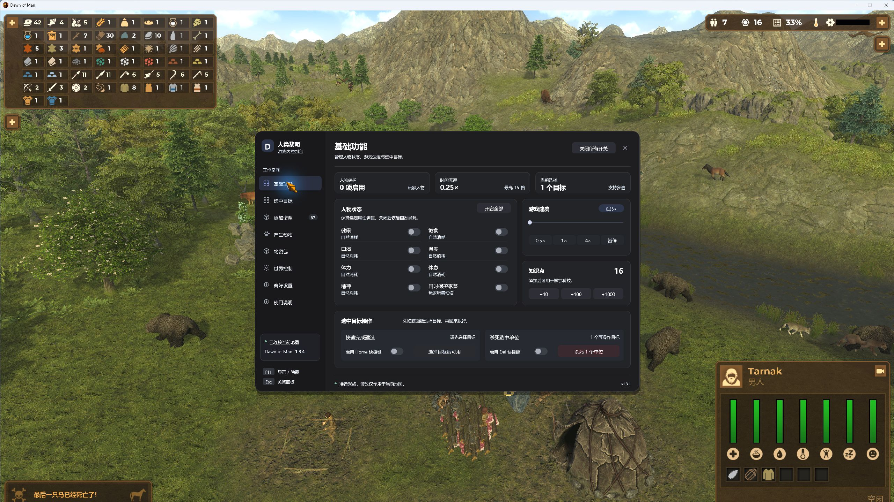
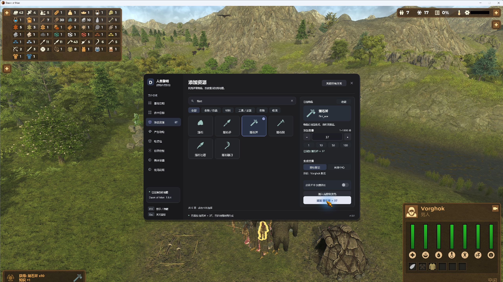

# 人类黎明内置修改器 · Dawn of Man Trainer

在游戏内按 **F11** 打开控制台，管理人物状态、资源、动物、建筑与世界。资源目录、物资包和偏好设置均集成在同一面板的标签页中。

**当前版本：v1.3.1** · 已验证：本机 Steam **Dawn of Man 1.8.4 / Unity 2022.3.62f2 / Windows**。

[下载安装包](https://github.com/lyfhc0305/dawn-of-man-trainer/releases/latest) · [详细说明](docs/使用说明.txt) · [更新记录](docs/更新说明.txt) · [验证记录](docs/验证结果.txt)



## 功能

| 标签页 | 功能 |
| --- | --- |
| 基础功能 | 七项人物属性锁、可选保护家畜、知识点、最高 15 倍速度、快速完成建造、选中单位操作 |
| 选中目标 | 平均生存状态预览、一次性恢复健康与属性、建筑缺料补给、建筑修缮、工具及衣物耐久、符合原生条件的幼年动物驯化 |
| 添加资源 | 真实游戏目录、名称或英文 ID 搜索、分类、收藏、手动数量、选中目标附近或画面中心生成 |
| 产生动物 | 选择物种、年龄、性别、数量与生成位置 |
| 物资包 | 保存与编辑多种资源清单、一次添加整包、先完整校验再按快照执行、停止后续生成 |
| 世界控制 | 0.25× / 0.5× 慢速、倍率切换、暂停、五种天气、原生流程邀请移民和商人 |
| 偏好设置 | 自定义单键、游戏键位冲突检查、面板自动暂停、收藏及物资包等偏好自动保存 |
| 使用说明 | 快捷键、添加资源步骤与使用提示 |



## 安装与使用

1. 在 [Releases](https://github.com/lyfhc0305/dawn-of-man-trainer/releases/latest) 下载完整 ZIP 并解压。
2. 退出游戏，运行解压目录里的 `安装.cmd`。默认路径为 `D:\Program Files (x86)\Steam\steamapps\common\DawnOfMan`。
3. 如果游戏位置不同，在解压目录中运行 `Installer.exe "你的游戏目录"`。
4. 启动游戏并进入地图，按 **F11** 打开 / 隐藏面板，**Esc** 关闭。
5. 对选中目标操作时，先隐藏面板，在地图中选择目标，再打开对应标签页。

默认 **Ins / Del / F10** 分别对应快速建造、选中单位操作与重复添加资源，需先在面板启用对应开关。F8 保留给原游戏家畜面板。持续修改与动作快捷键开关每次启动默认关闭。

安装器校验适配的游戏程序集，保留原始备份。卸载请先退出游戏，再运行 `卸载.cmd`，或执行 `Installer.exe --uninstall "你的游戏目录"`。

资源在地图地面生成，仍由村民搬运；建筑缺料补给仍需村民交付和施工。健康锁不会拦截寿命结束等直接死亡机制。实际修改结果会随用户存档保存。

## 验证

- 真实游戏内 **67 项通过 / 0 失败**，涵盖属性、知识、速度、建造、生成与新增功能。
- 离线 **145 项通过 / 0 失败**：76 项核心 / 功能 / 交付程序集检查，69 项界面检查。
- 实际键鼠验证页签切换、搜索、选中物品、手填 37、生成、收藏、整包生成、快捷键冲突、开关和关闭按钮。
- Astra 只读复审未发现明确交付阻碍；视觉 9.1/10，易用性 9.2/10。评分为审阅意见。

v1.3.1 修复原生窗口回调导致页签和编辑值被覆盖、线条图标缺失，以及概览 0.25× 倍率精度与自动暂停状态显示。

测试使用未保存临时地图及独立修改器偏好文件，没有创建地图存档。原游戏正常更新全局 Profile 的提示与镜头等记录。此次验证不涵盖长期稳定性、复杂旧档兼容和完整存读档流程。

完整日志、[审阅记录](docs/Astra界面评价.txt)与 [6 张真实游戏截图](docs/screenshots)在 `docs/`。Release ZIP 另含 24 张共享布局的离线预览。

## 从源码构建

需要 Windows 自带 .NET Framework C# 编译器，以及本机已安装的适配游戏。**不需要 .NET SDK**。

在 PowerShell 中运行：

```powershell
.\Build.ps1 -GamePath 'D:\Program Files (x86)\Steam\steamapps\common\DawnOfMan'
.\Test.ps1 -GamePath 'D:\Program Files (x86)\Steam\steamapps\common\DawnOfMan'
```

构建生成 `DawnOfManTrainer.dll` 和 `Installer.exe`；测试脚本运行离线检查，不启动游戏。游戏内诊断仅在显式指定 `--trainer-self-test` 时执行，普通启动不会执行测试或抑制自动存档。

```text
src/       修改器逻辑、共享界面、原生绘制、安装器和游戏内诊断
tests/     安全策略、偏好与暂停、程序集、界面检查及离线预览导出
docs/      使用说明、更新记录、验证日志、Astra 审阅与实测截图
Build.ps1  构建
Test.ps1   离线验证
```

构建时引用本机游戏程序集。仓库不包含游戏原程序集、反编译游戏源码或独立游戏素材。随附第三方依赖 Mono.Cecil 0.11.6，其许可证见 [Mono.Cecil.LICENSE.txt](Mono.Cecil.LICENSE.txt)。
